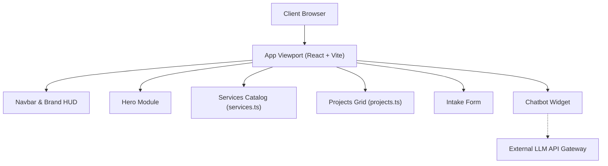

<div align="center">
  " alt="Shiva AI LLP Logo" width="120" />
  <h1>Shiva AI LLP Website</h1>
  <p><b>Futuristic portfolio and interactive consulting platform delivering end-to-end enterprise AI solutions.</b></p>

  <p>
    <a href="https://github.com/parmarjh/shiva-ai-website/actions"></a>
    <a href="#license"></a>
    
    
    
    
    
    
  </p>
</div>

---

### Preview & Live Demo

🔗 **Live URL:** [https://<!-- TODO: live-demo-url -->](https://<!-- TODO: live-demo-url -->)

```
+--------------------------------------------------------------------------+
|                                                                          |
|                   <!-- TODO: Add App Screenshot / GIF -->                |
|                    assets/preview.png or live app demo                   |
|                                                                          |
+--------------------------------------------------------------------------+
```

---

## Table of Contents

- [About](#about)
- [Features](#features)
- [Tech Stack](#tech-stack)
- [Architecture](#architecture)
- [Getting Started](#getting-started)
- [Environment Variables](#environment-variables)
- [Interactive Chatbot Setup](#interactive-chatbot-setup)
- [Customization](#customization)
- [Deployment](#deployment)
- [Roadmap](#roadmap)
- [Contributing](#contributing)
- [License](#license)
- [Contact & Socials](#contact--socials)

---

## About

Traditional enterprise consulting sites look static, corporate, and disconnected from modern artificial intelligence capabilities. This platform provides an immersive, high-performance web experience showcasing production AI consulting, workflow automation, and custom model architectures. Designed for enterprise leaders, founders, and technical executives looking to deploy scalable AI systems.

---

## Features

- **🚀 Hero Section**
  - Cyberpunk terminal styling with animated HUD elements and Orbitron typography.
  - Cyan-to-purple gradient backdrops and responsive CTA routing.
- **⚡ Services**
  - Highlighting generative AI engineering, autonomous agents, RAG systems, and on-premise LLM infrastructure.
  - Interactive grid with hover effects and detailed capability scopes.
- **💼 Projects & Case Studies**
  - Showcase cards with metric callouts, architecture tags, and repository links.
  - Filterable by solution domain (Computer Vision, NLP, Agents, Data Systems).
- **🤖 Interactive Chatbot**
  - On-page floating AI assistant providing instant business qualification and technical FAQ responses.
  - Swappable interface: operates offline via client-side intents or connected to an LLM endpoint.
- **📬 Contact & Intake**
  - Structured engagement inquiry form with client-side validation.
  - Direct integration points for webhook, email, or CRM dispatch.

---

## Tech Stack

| Layer | Technology | Purpose |
|---|---|---|
| **Frontend Framework** | React 18 | Declarative component structure and optimized virtual DOM updates. |
| **Build Tool** | Vite 5 | Instant HMR and rollup-optimized production bundling. |
| **Language** | TypeScript 5 | Strict static typing across components, props, and data models. |
| **Styling** | Tailwind CSS 3.4 | Utility-first cyberpunk design system, gradients, and typography tokens. |
| **Component Kit** | shadcn/ui + Radix Primitives | Accessible, unstyled UI primitives customized with Tailwind tokens. |
| **Icons** | Lucide React | Lightweight, tree-shakeable iconography. |

---

## Architecture



```
.
├── public/                 # Static assets, favicon, brand symbols
├── src/
│   ├── assets/             # Brand logos, illustrations, backgrounds
│   ├── components/         # Page sections and composite blocks
│   │   ├── ui/             # shadcn/ui primitives (Button, Card, Input, Dialog)
│   │   ├── Chatbot.tsx     # Interactive chatbot interface
│   │   ├── Contact.tsx     # Intake contact form
│   │   ├── Hero.tsx        # Hero banner with terminal accents
│   │   ├── Navbar.tsx      # Navigation header
│   │   ├── Projects.tsx    # Showcase cards
│   │   └── Services.tsx    # Core consulting offerings
│   ├── data/               # Content files (services.ts, projects.ts)
│   ├── hooks/              # Custom utility React hooks
│   ├── lib/                # Helper utilities (cn, formatting)
│   ├── styles/             # Global styles, fonts, gradient declarations
│   ├── App.tsx             # Root page layout
│   └── main.tsx            # Entry point
├── index.html              # HTML head with Orbitron font import
├── tailwind.config.ts      # Cyberpunk color tokens and typography extensions
├── tsconfig.json           # TypeScript configuration
└── vite.config.ts          # Vite build and path alias configuration
```

---

## Getting Started

### Prerequisites

- Node.js `>= 18.x`
- Package manager: `npm` (or `pnpm` / `yarn`)

### Installation & Run

1. **Clone the repository:**
   ```bash
   git clone https://github.com/parmarjh/shiva-ai-website.git
   cd shiva-ai-website
   ```

2. **Install dependencies:**
   ```bash
   npm install
   ```

3. **Configure environment:**
   ```bash
   cp .env.example .env
   ```

4. **Start local development server:**
   ```bash
   npm run dev
   ```
   Open `http://localhost:5173` in your browser.

5. **Build for production:**
   ```bash
   npm run build
   ```

6. **Preview production build:**
   ```bash
   npm run preview
   ```

---

## Environment Variables

Configure application settings in `.env`:

| Name | Required | Description | Example |
|---|---|---|---|
| `VITE_APP_URL` | No | Public site URL | `https://shiva-ai.com` |
| `VITE_CHATBOT_API_URL` | No | LLM backend endpoint for assistant widget | `https://api.shiva-ai.com/chat` |
| `VITE_CONTACT_WEBHOOK_URL` | No | Webhook endpoint for intake contact form | `https://hooks.zapier.com/hooks/catch/...` <!-- TODO --> |

---

## Interactive Chatbot Setup

The widget located in `src/components/Chatbot.tsx` operates in two modes:

1. **Standalone Heuristic Mode (Default):**
   - Matches user inputs against pre-configured keyword intent rules.
   - Requires zero backend infrastructure or API keys.
2. **Connected LLM Backend:**
   - Set `VITE_CHATBOT_API_URL` in `.env`.
   - Update the fetch call in `src/components/Chatbot.tsx` to stream or return `{ reply: string }`.

To customize default responses, edit the response mapping object in `src/data/chatbotKnowledge.ts` (or `src/components/Chatbot.tsx`).

---

## Customization

- **Services & Offerings:** Update item arrays in `src/data/services.ts`.
- **Project Case Studies:** Add screenshots, tags, and links in `src/data/projects.ts`.
- **Theme Gradients & Tokens:** Edit color definitions in `tailwind.config.ts`:
  - Primary Cyan/Teal: `colors.cyan` / `#00f2fe`
  - Neon Purple: `colors.purple` / `#9d4edd`
- **Typography:** Display headings load the `Orbitron` font via `index.html`. Modify font families in `tailwind.config.ts`.
- **Social Links:** Update profile URLs in `src/components/Footer.tsx` and `src/components/Navbar.tsx`.

---

## Deployment

### Vercel
1. Push code to GitHub.
2. Import project into [Vercel](https://vercel.com).
3. Framework preset: **Vite**, Build command: `npm run build`, Output directory: `dist`.
4. Deploy.

### Netlify
1. Connect repository in [Netlify](https://www.netlify.com).
2. Set Build command to `npm run build` and Publish directory to `dist`.
3. Add single-page routing rewrite in `public/_redirects`: `/* /index.html 200`.

### Lovable
1. Export project or synchronize branch directly with your [Lovable](https://lovable.dev) workspace.
2. Configure publish domain in dashboard settings.

---

## Roadmap

- [x] Responsive dark cyberpunk layout with Orbitron font.
- [x] Client-side interactive chatbot assistant.
- [x] Case studies matrix with live modal previews.
- [ ] Direct streaming integration with FastAPI / LangChain backend.
- [ ] Interactive 3D WebGL hero background using Three.js / React Three Fiber.
- [ ] Multi-language localization (English, Hindi, Gujarati).

---

## Contributing

Contributions are welcome. Follow these steps:

1. Fork the repository.
2. Create your branch: `git checkout -b feature/amazing-feature`.
3. Commit with [Conventional Commits](https://www.conventionalcommits.org/): `git commit -m "feat: add particle canvas to hero"`.
4. Push to branch: `git push origin feature/amazing-feature`.
5. Open a Pull Request ensuring lint and build pass (`npm run build`).

---

## License

This project is licensed under the <!-- TODO: Select License (e.g. MIT License) -->. See the `LICENSE` file for details.

---

## Contact & Socials

**Jatin Parmar** &bull; Founder, **Shiva AI LLP** (Surat, India)

<p>
  <a href="https://www.linkedin.com/in/jhparmar"></a>
  <a href="https://github.com/parmarjh"></a>
  <a href="https://jhparmar.medium.com"></a>
  <a href="https://dev.to/jhparmar"></a>
  <a href="https://www.youtube.com/channel/UCSLMS3odjPxesH02jnhWMnA"></a>
</p>

---

<div align="center">
  <sub>Built with ❤️ by Shiva AI LLP</sub>
</div>
